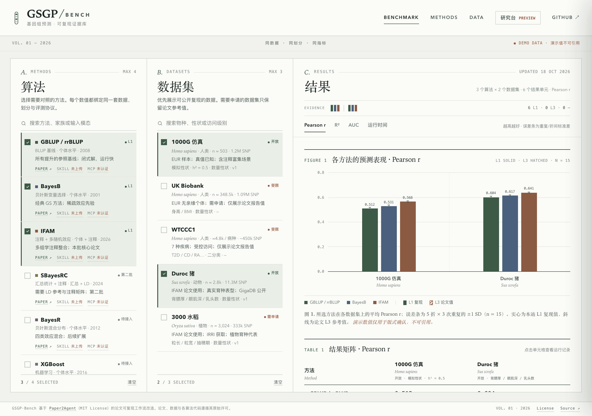
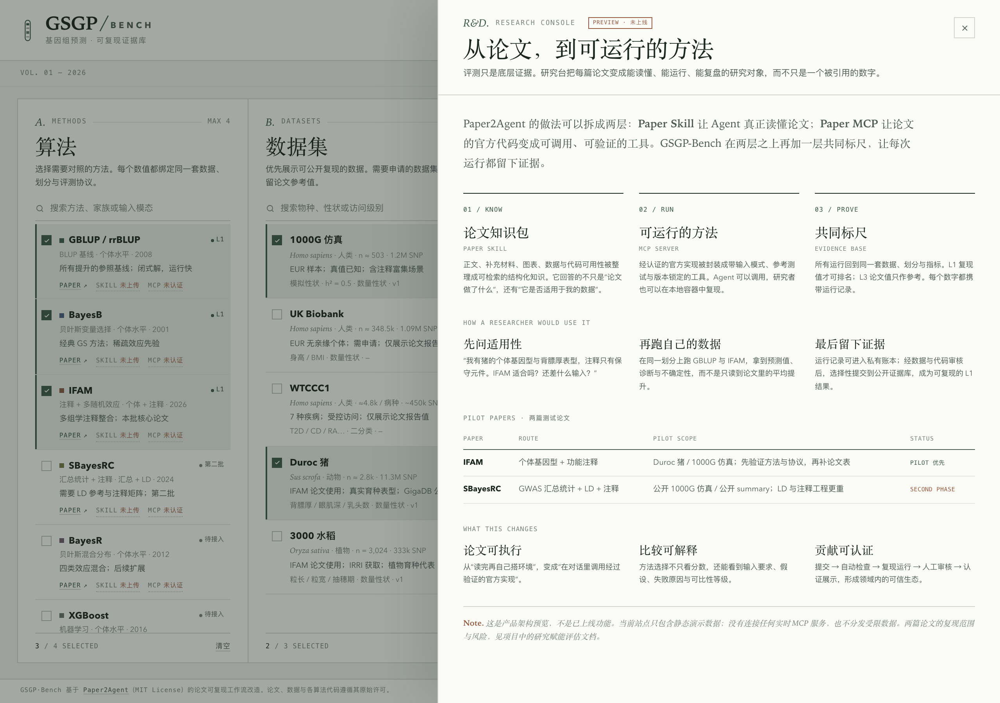
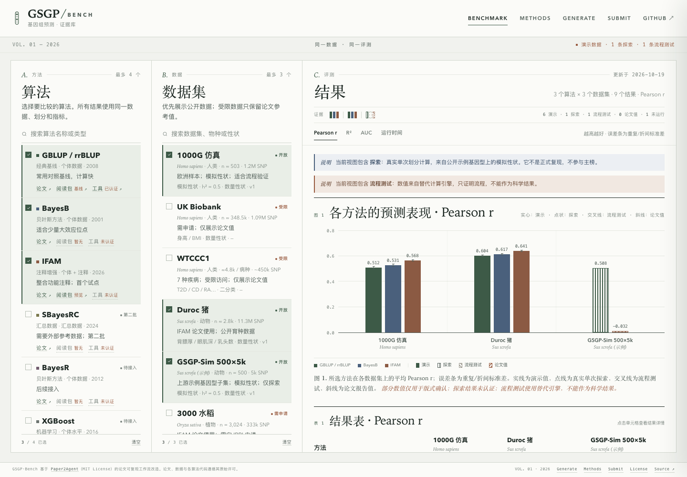

# GSGP-Bench：基于 Paper2Agent 的基因组预测算法基准站

> 版本：v0.1（2026-10-18）
> 依据：第一次会议纪要、Paper2Agent 论文（Nature, DOI: 10.1038/s41586-026-11044-y）、IFAM 论文（Nature Communications, DOI: 10.1038/s41467-026-72470-0）、SBayesRC 论文（Nature Genetics, DOI: 10.1038/s41588-024-01704-y）以及当前 Paper2Agent 仓库代码。

---

## 0. 先给结论

这个项目**不是**“把 Paper2Agent 改成一个网站”，而是三层东西的组合：

1. **领域化改造层**：把 Paper2Agent 从通用论文转 Agent，改造成适配 GSGP 的“论文 → 可验证 MCP Server”生产线。
2. **基准协议层**：定义统一数据、统一划分、统一指标、统一溯源格式，并有一个离线 runner 真正把算法跑出结果。
3. **展示层**：一个静态结果站，左列算法、中列数据集、右列结果，部署在 Cloudflare Workers（Static Assets），推送即自动更新。

关键判断：

- **Cloudflare 只托管网站，不负责跑算法。** R/GCTB、GB 级 LD 矩阵、CPU 小时级训练无法在 Workers 里完成。网站读取的是已经跑完、已提交到仓库的结果 JSON；Worker 仅额外提供一个轻量 AI 文字解读接口。
- **首批主榜必须用完全开放的数据。** UK Biobank、WTCCC 需要申请，无法公开复现；它们最多作为“论文报告值”参考，不能和开放数据的复现结果放在同一张榜上排名。
- **最先验证的不是前端，而是“论文代码 → MCP → 在固定小数据上产出预测”这条链路。** 这是会议纪要里指出的最大风险，也是整个项目能不能成立的前提。
- **“用户上传论文后实时参与计算”需要分阶段。** v1 用 GitHub 提交表单 + 人工审核 + 离线跑批；v2 再做上传、队列、自动转换、PR 审核。不要在 Cloudflare Worker 里执行不可信论文代码。
- **MCP 的准确含义**：Model Context Protocol（模型上下文协议），不是“最小可编程单元”。一个 MCP Server 可以暴露多个 tools/resources/prompts；网站里的“一个算法”通常对应一篇论文的 MCP Server，而不是单个 tool。

建议的 MVP：**3 个算法 × 2 个开放数据集，全部同数据同划分复现**；先让 20～30 个结果单元真实跑通，再谈扩充。

### 快速 Demo 版（当前优先）

你的目标是“先快速做一个 demo”，因此把“真实跑通 MCP”与“网站演示”拆开，Demo 不等待长链路：

- **目标**：3～5 天做出可打开、可交互、可部署到 Cloudflare Workers 的演示站。
- **范围**：4 个算法 × 3 个数据集；三列布局、多选、指标切换、误差条、结果矩阵、详情抽屉、URL 状态。
- **数据**：优先使用开放/仿真数据的真实结果；如果暂时没有，就用**明确标注的演示值**占位，绝不让占位数字看起来像实测结论。
- **不做**：真实 MCP 运行、论文上传后端、UKB/WTCCC 申请、在线计算。
- **交付**：静态站 + 结果 JSON 示例 + GitHub 仓库骨架 + Cloudflare 部署说明 + 演示免责声明。
- **下一步**：用 GBLUP/IFAM 在一个 tiny fixture 上的真实结果，逐个替换占位单元格；网站结构不变。

这样既能让团队快速看到产品形态，又不会把“演示值”误当成科学结论。

### 当前交付快照（2026-10-18）

仓库已经越过“只有演示站”的阶段，但还没有真实基准结果：

- **Paper2Skill**：IFAM 论文包已完成严格校验，状态 `reviewed_with_limitations`；站点提供阅读预览和可下载 ZIP，缺失补充材料已记录。
- **MCP**：4 工具 draft 契约、合成 tiny fixture、本地 stdio 原型和独立 runner 已实现；tiny inspect 黄金输出与真实 IFAM.R + fake HIBLUP dry-run 通过，尚无部署服务，没有通过真实 HIBLUP 执行验证。HIBLUP v1.1.0 当前不易获得，真实执行暂时挂起。
- **Benchmark**：GBLUP 已手动封装为 baseline Skill/MCP（MCP 包已认证），并完成第一条真实 exploratory 记录（500×5k 模拟性状，单次 80/20，Pearson r 0.508）；IFAM 用 fake HIBLUP 填充 STUB 单元格。页面其余数值仍是演示值，没有 L1 认证。
- **证据层**：`benchmark/schema/result.v1.json`、GBLUP EXP、IFAM STUB 与认证记录已建立；STUB/EXP/L1/L3 在站点分离展示。
- **数据**：没有执行任何自动下载；用户已下载 IFAM `main.zip` 并完成格式核对；R 4.6.1 + optparse 1.8.2 已安装，HIBLUP 暂缺；PLINK 可选。
- **下一步门槛**：继续做独立 runner 结果契约、多 split/审核流程和前端证据展示；取得 HIBLUP v1.1.0 后再运行 IFAM 真实 acceptance。

---

## 1. 先读懂 Paper2Agent

### 1.1 它到底是什么

Paper2Agent 是给编码 Agent（Claude Code、Codex 等）使用的一套 **skill + 多智能体工作流**，不是一个可以直接 `docker run` 的平台。它包含两半：

| 组件 | 输入 | 输出 | 作用 |
| --- | --- | --- | --- |
| Paper2Skill | 论文 PDF、补充材料、表格、图 | 结构化、可检索的 paper skill | 让 Agent 读懂论文的方法、数据、图表和结论 |
| Paper2MCP | 论文配套代码仓库 | 经过验证的 MCP Server + skill + USAGE.md + ZIP | 把仓库能力封装成可被 AI 调用的工具 |

Paper2MCP 的流程是：环境配置 → 扫描仓库/教程、选择有用工具 → 执行原始代码得到参考结果 → 并行实现工具 → 独立 verifier 验证 → MCP 集成 → 运行时安装验证 → 文档与 ZIP 交付。核心约束是：**每个 tool 必须绑定仓库里已有的真实代码，不能凭空发明算法**。

论文里给出的量级（用于建立预期）：

- 处理 100 篇计算生物学论文，74 篇成功 agent 化（约 74%）。
- 生成 599 个工具，593 个通过自动验证。
- AlphaGenome：22 个工具，约 45 分钟、14 美元；Scanpy：7 个工具，约 45 分钟、13 美元（论文报告值）。
- 结论：可行，但**远不是 100% 稳定**；失败主要来自代码缺失、环境不可复现、依赖/数据问题。

### 1.2 它不提供什么

- 没有网站、数据库、排行榜或基准协议。
- 不做长时任务调度，不负责托管计算。
- 不保证生成的 MCP 在另一台机器、另一批数据上仍然可用。
- 不解决“不同论文的方法是否可比”这个科学问题。

所以我们的改造重点是：**领域约束 + 统一接口 + 统一评测 + 稳定性和溯源**，而不是重写它的 Agent 调度。

### 1.3 对本项目的直接启示

- 复用它的 skill、`verify_workflow.py`、`verify_mcp_server.py` 和交付规范，不要从零造。
- 在它的外面加一层 **GSGP Benchmark Adapter**：MCP 只负责“跑方法、出预测”，指标计算统一由 runner 做。
- 单个算法转换失败时，网站仍应展示该算法的“论文报告值”与失败原因，而不是空白或假数据。

---

## 2. 两篇核心论文的可转化性分析

这两篇正好代表 GSGP 里两条不同技术路线：IFAM 走**个体基因型 + 多组学注释**，SBayesRC 走**GWAS 汇总统计 + LD + 功能注释**。

| 维度 | IFAM | SBayesRC |
| --- | --- | --- |
| 方法定位 | 扩展 GBLUP，多随机效应整合大量功能注释 | 基于 summary statistics 的贝叶斯 PGS，整合注释与全基因组变异 |
| 输入 | 个体基因型、表型、功能注释 | GWAS summary stats、LD 参考、功能注释 |
| 输出 | 估计育种值/预测值 | PGS、SNP 效应、后验概率、遗传参数 |
| 官方代码 | `xiaolei-lab/IFAM`，论文标注 MIT | `zhilizheng/SBayesRC` + GCTB |
| 主要数据 | WTCCCI、UKB（申请号 97563）、Duroc 猪（GigaDB 100894）、Yorkshire 猪（Figshare；原始基因型 EVA 2028 年才开放）、3000 Rice Genomes | UKB、UK10K、LifeLines（均需申请）；1000G、FinnGen、BBJ、PAGE 等公开汇总数据 |
| 指标 | 数量性状 Pearson 相关；疾病性状 AUC；80/20 划分，10 或 20 次重复 | 预测 R²、相对预测准确率；UKB 10 折交叉验证；二分类用 AUC |
| MCP 化难度 | 中：R 环境、注释矩阵、表型/协变量处理 | 高：R + GCTB、~7M SNP、GB 级 LD 矩阵、大文件 IO |
| 对本项目的建议 | 作为首批真实数据算法（Duroc/水稻/仿真） | 作为第二批；优先在 1000G 仿真或公开 summary 上跑，不用 UKB 做公开主榜 |

需要注意的论文细节：

- IFAM 在 WTCCCI 上相对 GBLUP 平均提升 9.46%，UKB 6.15%，Duroc 4.59%，Yorkshire 4.09%，水稻 10.83%；但去掉 trait-specific GWAS 注释后，UKB 仅剩 1.40% 提升。这说明“注释有没有用”高度依赖数据、组织和注释质量，**单一数据集上的提升不能外推**。
- SBayesRC 报告相对 SBayesR 在欧洲人群提升约 14%，跨祖先最高约 34%；它依赖大样本 LD 参考和高质量的注释/汇总统计。跨祖先场景的参考面板匹配是关键风险。
- 两篇论文的“提升”都是相对各自 baseline、在各自划分下得到的。**不能把论文里的百分比直接搬到我们的网站上横比。**

### 2.1 为什么不能直接拿 UKB/WTCCC 做主榜

- 数据访问受控，无法公开分发，也无法让外部用户复现。
- 网站可以展示“论文报告值”，但必须明确标注 `paper_reported`，不能与 `reproduced` 混排。
- 公开主榜应使用开放数据：1000G 仿真、Duroc 猪、3000 水稻、公开小麦/玉米数据等。

---

## 3. 产品定义

### 3.1 用户与核心问题

目标用户：GSGP 研究者、动植物育种人员、生信/统计学生、想快速了解方法差异的工程人员。

他们来网站只想回答三个问题：

1. 这个领域有哪些代表性算法？各自属于什么路线、需要什么输入？
2. 有哪些常用数据集？是否开放、什么物种、什么性状？
3. 在**同数据、同划分、同指标**下，各算法表现如何？结果能不能追溯、能不能复现？

### 3.2 三条产品原则

1. **同数据同划分才排名。** 不同划分、不同指标、不同输入模态的数字，只能作为参考，不能放在同一张排行榜里。
2. **每个数字都能追溯。** 从页面上的一个指标，可以点到 run ID、代码 commit、镜像 digest、数据校验和、划分文件、环境版本、日志。
3. **失败和不可比也要展示。** “跑不起来”“不可比”“只有论文值”都是有价值的信息，不能用空白或假数据掩盖。

### 3.3 v1 非目标

- 不在网页上实时训练模型。
- 不做“上传即发布”的全自动流水线。
- 不追求覆盖整个 GSGP 文献。
- 不输出跨数据集的综合总分/总排名（会误导）。

---

## 4. 系统架构

```text
┌──────────────────────────── 离线生产层（本地/自托管 runner） ────────────────────────────┐
│                                                                                          │
│  论文 PDF ──► GSGP-Paper2Agent ──► paper skill                                          │
│  代码仓库 ──►   (Paper2MCP 改造)  ──► MCP Server（Docker，固定环境）                     │
│                                          │                                               │
│                                          ▼                                               │
│                              GSGP Benchmark Adapter                                      │
│                     （统一 fit/predict 接口，输出 predictions.tsv）                      │
│                                          │                                               │
│                                          ▼                                               │
│                    Benchmark Runner（固定数据 + 固定划分 + 统一 evaluate.py）             │
│                                          │                                               │
│                                          ▼                                               │
│                     results/*.json（含溯源、指标、失败状态）──► git commit / PR          │
│                                                                                          │
└──────────────────────────────────────────────────────────────────────────────────────────┘
                                           │
                                           ▼
┌──────────────────── 在线展示层（Cloudflare Workers） ─────────────────────┐
│  Static Assets（三列筛选 → 结果矩阵/图表/详情） + /api/analyze 文字解读   │
│  GitHub push 到 main → 自动构建部署；PR → 预览部署                        │
└──────────────────────────────────────────────────────────────────────────┘
```

### 4.1 为什么这样分层

- **可复现**：结果由固定环境、固定数据、固定划分产生，不依赖浏览器或边缘计算。
- **成本低**：网站是静态资源，Worker 只处理一个受限的分析接口，Cloudflare 免费额度足够；计算只在需要时占用自己的机器/runner。
- **可审计**：结果 JSON 和代码一起进 Git，每个数字都有 commit 可查。
- **可渐进**：以后要加在线运行，只需在展示层后面接一个计算 API，不用推翻网站。

### 4.2 如果以后真要做“在线运行”

可选后端：Modal、RunPod、Hugging Face Spaces、实验室服务器/自托管 runner。Cloudflare 只做鉴权、限流、任务状态和结果展示。不要在 Worker 里跑 R/GCTB，也不要让匿名用户直接执行论文代码。

---

## 5. 仓库结构

建议在 fork 后把仓库整理成“技能 + 基准 + 网站”的 monorepo：

```text
GSGP-Bench/
├── README.md
├── LICENSE                         # 保留上游 MIT 声明
├── skills/
│   ├── paper2agent/                # 上游 skill，尽量少改，便于同步 upstream
│   └── gsgp-paper2agent/           # 新增：GSGP 领域包装层 + 领域规则
│       ├── SKILL.md
│       └── references/
│           ├── gsgp-conventions.md
│           ├── benchmark-contract.md
│           └── failure-taxonomy.md
├── agents/                         # 生成的 MCP Server（每个算法一个目录/子模块）
│   ├── gblup/
│   ├── bayesb/
│   ├── ifam/
│   └── sbayesrc/
├── benchmark/
│   ├── datasets/
│   │   ├── 1000g-sim/
│   │   │   ├── dataset.yaml
│   │   │   ├── prepare.py
│   │   │   └── splits/
│   │   └── duroc-pig/
│   ├── algorithms/
│   │   ├── gblup.yaml
│   │   ├── bayesb.yaml
│   │   ├── ifam.yaml
│   │   └── sbayesrc.yaml
│   ├── adapters/                   # 每个算法的统一适配器
│   ├── runner/                     # CLI：run / evaluate / validate / publish
│   ├── evaluate.py                 # 唯一的指标计算入口
│   └── schema/result.schema.json
├── results/                        # 归一化结果 JSON，按数据集/算法组织
├── site/                           # Vite + React + TypeScript 静态站
│   ├── src/
│   ├── public/results -> ../../results（构建时复制或软链）
│   └── package.json
├── .github/
│   ├── ISSUE_TEMPLATE/submit-paper.yml
│   └── workflows/
│       ├── validate.yml            # schema / 构建 / 链接检查
│       └── ingest-paper.yml        # 可选：触发离线转换
└── docs/
```

原则：`skills/` 尽量保持上游结构，领域改造放在 `gsgp-paper2agent/`，这样以后合并 upstream 不会痛苦。

---

## 6. 基准协议（项目最重要的部分）

### 6.1 数据集描述文件

```yaml
# benchmark/datasets/duroc-pig/dataset.yaml
id: duroc-pig
name: Duroc pig
version: v1
species: pig
source:
  type: public
  url: https://doi.org/10.5524/100894
  license: TODO_VERIFY
  redistribution: allowed
access: open            # open | application | restricted | embargo
genome_build: TODO
n_individuals: TODO
n_markers: TODO
traits:
  - id: backfat
    type: quantitative
    description: TODO
  - id: ...
covariates: [sex, batch]
qc:
  maf: 0.01
  missing_rate: 0.05
  hwe: 1e-6
splits:
  scheme: 5fold_x3seeds
  files: splits/fold_*.txt
checksums:
  genotype: sha256:...
  phenotype: sha256:...
```

### 6.2 算法描述文件

```yaml
# benchmark/algorithms/ifam.yaml
id: ifam
name: IFAM
paper:
  title: Improving genomic prediction accuracy of complex traits by integrating massive types of functional annotation information
  doi: 10.1038/s41467-026-72470-0
  year: 2026
family: annotation-bayesian
input: individual       # individual | summary
mcp:
  path: agents/ifam
  transport: stdio
  verified: false
code:
  repo: https://github.com/xiaolei-lab/IFAM
  commit: TODO
  license: MIT
adapter: benchmark/adapters/ifam.py
environment:
  image: ghcr.io/<org>/gsgp-ifam:sha-...
status: planned         # planned | converting | verified | failed
```

### 6.3 结果 JSON

一个“结果单元”= 算法 × 数据集 × 性状 × 划分方案 × 版本。示例：

```json
{
  "run_id": "ifam__duroc-pig__backfat__5fold-s42__20261018T120000Z",
  "status": "reproduced",
  "algorithm": { "id": "ifam", "version": "1.0.0", "commit": "abc123" },
  "dataset": { "id": "duroc-pig", "version": "v1", "trait": "backfat", "checksum": "sha256:..." },
  "split": { "scheme": "5fold_x3seeds", "file": "splits/fold_01.txt", "seed": 42 },
  "metrics": {
    "pearson": 0.612,
    "r2": 0.374,
    "mse": 1.23,
    "spearman": 0.598,
    "auc": null
  },
  "uncertainty": { "n_repeats": 3, "pearson_sd": 0.014, "per_fold": [0.601, 0.618, 0.617] },
  "runtime": { "seconds": 1830, "cpu_cores": 8, "peak_ram_gb": 16.2, "gpu": null },
  "environment": {
    "image": "ghcr.io/org/gsgp-ifam@sha256:...",
    "r": "4.4.1",
    "os": "linux/amd64"
  },
  "artifacts": {
    "predictions": "artifacts/ifam__.../pred.tsv",
    "log": "artifacts/ifam__.../run.log",
    "manifest": "artifacts/ifam__.../manifest.json"
  },
  "created_at": "2026-10-18T12:00:00Z",
  "notes": null
}
```

`status` 枚举：

| 状态 | 含义 | 是否进主榜 |
| --- | --- | --- |
| `reproduced` | 我们跑通，同数据同划分同指标 | 是 |
| `paper_reported` | 仅转录论文数字，未复现 | 否，单独参考区 |
| `not_comparable` | 输入模态/划分/指标不同 | 否，显示原因 |
| `failed` | 运行失败 | 否，显示失败原因与日志 |
| `running` | 进行中 | 否 |
| `planned` | 已登记未运行 | 否 |

### 6.4 可比性分级（页面上必须有 badge）

- **L1 同数据同划分复现**：绿色，唯一可排名的主榜。
- **L2 同数据不同输入**：黄色。例如 summary-stat 方法用训练折生成的汇总统计，和个体水平方法共用同一数据/划分，但输入形态不同。
- **L3 论文报告值**：灰色/琥珀色。只做背景参考，不与 L1 混排。
- **L4 不可比**：红色。显示具体原因（不同性状定义、不同祖先、不同划分、不同指标等）。

### 6.5 统一指标

- 数量性状：Pearson r、R²（明确写成“预测值与观测值的平方相关”）、MSE、MAE、Spearman。
- 二分类性状：AUC；可选 log-loss、准确率。
- 不确定性：同一划分方案下的多次重复/多折，报告 mean ± sd，并保留 per-fold 值用于箱线图。
- 运行成本：wall time、CPU 核数、峰值内存；GPU 可选。
- 所有指标由 `benchmark/evaluate.py` 统一计算，**不采用算法仓库自己打印的指标**。

### 6.6 公平性规则

- 统一 SNP 集、MAF/缺失率/HWE 过滤、表型变换、协变量。
- 划分文件必须提交到仓库，所有方法读同一份。
- summary-stat 方法的 GWAS 只能在训练折上做，LD 参考和验证集不能泄漏。
- 统一缺失值处理和预测输出格式（`sample_id, predicted_value`）。
- 同一视图只比较同一指标、同一性状类型。
- 记录数据访问级别；受限数据只发布指标和元数据，不发布原始数据。

---

## 7. MVP 范围

### 7.1 算法（首批 3 个 + 1 个第二批）

| 算法 | 路线 | 输入 | 首批 | 说明 |
| --- | --- | --- | --- | --- |
| GBLUP / rrBLUP | BLUP 基线 | 个体 | 是 | 必须有基线，所有提升都相对它解释 |
| BayesB | 贝叶斯变量选择 | 个体 | 是 | GS 常用经典方法 |
| IFAM | 注释 + 多随机效应 | 个体 + 注释 | 是 | 会议指定的核心论文之一 |
| SBayesRC | summary + 注释 | 汇总统计 + LD | 第二批 | 环境/数据最重，单独攻坚 |
| SBayesR | summary 基线 | 汇总统计 + LD | 第二批 | 作为 SBayesRC 的去注释对照 |
| BayesR / Elastic Net / XGBoost | 其他基线 | 个体 | 后续 | 用于扩展对比，不阻塞 MVP |

### 7.2 数据集（首批 2 个开放数据）

| 数据集 | 类型 | 为什么选 | 访问 |
| --- | --- | --- | --- |
| 1000G 仿真 | 人类、个体 + 汇总 | 完全开放；可真值已知；能同时服务个体和 summary 方法；可设计“注释是否富集”的场景 | 开放 |
| Duroc 猪 | 动物、真实表型 | 公开；有真实育种性状；IFAM 论文实际用过；对动物育种用户有说服力 | 开放（GigaDB 100894） |
| 3000 Rice Genomes | 植物、真实表型 | IFAM 论文用过；植物育种代表 | 需在 IRRI 获取，待核 |
| WTCCC / UKB | 人类、受限 | 论文报告值参考 | 申请/受限 |

首批不做 UKB/WTCCC 的复现，只在第二批加“论文报告值”参考行。这样避免项目一开始就被数据申请卡住。

### 7.3 首批结果规模

- 3 个算法 × 2 个数据集 × 1～2 个性状 × 3 次重复/5 折 ≈ 20～30 个结果单元。
- 目标不是“多”，而是**每个数字都能从页面追到日志和 commit**。
- 页面默认只展示 `reproduced`；参考区单独折叠。

### 7.4 MVP 验收标准

- 任意选 2 个算法 + 1 个数据集，能在 2 秒内看到对比结果和误差条。
- 每个单元格能点开看到：run ID、代码 commit、环境、划分文件、指标定义、日志、数据校验和。
- 至少 1 个算法从“论文仓库 → MCP → 统一预测输出 → 网站结果”全链路跑通。
- 任意一个结果 JSON 通过 schema 校验；构建时坏数据会让 CI 失败。
- 推送 `main` 后 Cloudflare 自动部署；PR 有预览地址。
- 页面明确区分 `reproduced` / `paper_reported` / `not_comparable`，没有误导性混排。

---

## 8. 站点设计

### 8.1 布局

严格按会议纪要的三列：

```text
┌────────────────────────────────────────────────────────────────────────────┐
│ GSGP-Bench  可复现的基因组预测算法基准           [中文/EN] [GitHub] [关于] │
├───────────────┬───────────────────┬────────────────────────────────────────┤
│ 算法（多选）  │ 数据集（多选）    │ 结果                                   │
│ [搜索]        │ [搜索]            │ 已选 3 算法 × 2 数据集 · 6 组          │
│               │                   │ [Pearson r] [R²] [AUC] [运行时间]      │
│ ☑ GBLUP      │ ☑ 1000G 仿真      │ ┌ 对比图（分组柱状 + 误差条）───────┐ │
│ ☑ BayesB     │   人类 · 开放     │ │                                  │ │
│ ☑ IFAM       │ ☑ Duroc 猪        │ └──────────────────────────────────┘ │
│ ☐ SBayesRC   │   动物 · 开放     │ ┌ 结果矩阵 ────────────────────────┐ │
│ ☐ BayesR     │ ☐ 3000 水稻       │ │ 算法   数据集A   数据集B   状态   │ │
│               │ ☐ UKB（参考）     │ │ GBLUP  0.52±.01 0.61±.02  复现   │ │
│               │                   │ │ IFAM   0.58±.01 0.64±.01  复现   │ │
│ [清空]        │ [清空]            │ └──────────────────────────────────┘ │
│ 最多对比 4 个 │ 最多对比 3 个     │ 点击单元格 → 右侧滑出运行详情         │
└───────────────┴───────────────────┴────────────────────────────────────────┘
```

### 8.2 算法卡片信息

名称、方法家族、论文/年份、输入类型（个体/汇总）、复现等级、许可证、是否可比提示。v1 还在每张卡片下沿实现了一条 **Paper / Skill / MCP 证据链**：

- Paper 链接到论文 DOI，并在悬浮提示中显示作者、年份与期刊。
- Skill 与 MCP 只有在真实存在并通过审核后才渲染为链接；缺项直接显示“未上传”或“未认证”。
- IFAM Skill 已接入公开阅读预览，因此显示“预览”而不是“未上传”；它仍是 `reviewed_with_limitations`，不是基准认证。
- 缺项提示支持鼠标悬浮、键盘聚焦和触屏点按，并说明原因；不用空链接伪装已有资源。
- 当前没有任何已认证的 GSGP MCP；IFAM 标注首批试点且仍是 draft，SBayesRC 标注第二批。

默认按“可复现优先、论文年份”排序，支持搜索。

### 8.3 数据集卡片信息

名称、物种、性状（可展开多选）、样本量、标记数、访问级别（开放/申请/受限/禁运）、许可证、数据版本。受限数据灰显并解释“为什么不能进主榜”。

### 8.4 结果区

- 顶部摘要：选中组合数、可复现数、参考数、最近更新时间。
- 指标切换：数量性状默认 Pearson r；二分类自动切 AUC；同一视图不允许混用指标。
- 对比图：分组柱状图 + 误差条；颜色按算法；不要用红绿作为唯一区分（色盲友好）。
- 结果矩阵：行=算法，列=数据集·性状；单元格显示值 ± sd 和状态 badge；缺数据明确显示“未运行”，不要留空。
- 详情抽屉：运行信息、环境、划分、指标、日志、产物下载、论文链接、许可证。
- 提示条：当选择里混有 `paper_reported` 或 `not_comparable` 时，顶部出现黄/红提示，并说明原因。
- URL 状态：算法、数据集、指标、性状都写入 query string，可分享、可刷新还原。
- 导出：CSV（当前视图）、PNG（图表），并在导出文件里带上 run ID 和状态。

### 8.5 视觉风格

实际 v1 采用“学术期刊证据板”方向，而不是卡片式仪表盘：

- 冷灰纸面 + 米白证据板 + 深墨文字；苔绿为主色，赤陶色只用于论文报告值/风险提示。
- 标题用衬线体，正文用无衬线体，数据注记、坐标、状态用等宽字体；有效数字统一。
- 三栏用发丝线分隔，A / B / C 栏标；结果区使用 Figure 1 / Table 1 的图表规范和图注。
- 复现值用实心柱，论文报告值用斜线填充柱；L1 / L3 不靠颜色单独区分。
- 页脚保留 Paper2Agent 的 MIT 归属和 License 链接。
- 移动端：三列纵向重排，结果表横向滑动并给出提示，研究台全屏展示。
- 动效克制：只保留首屏栏位淡入和柱形生长，并完整支持 `prefers-reduced-motion`。

> 2026-10-18 更新：实际 v1 已在 [`site/index.html`](../site/index.html) 实现，视觉方向定为“学术期刊证据板”，不再使用早期的卡片式线框。





当前实现已经覆盖：算法/数据集多选与上限、搜索、指标切换（Pearson r / R² / AUC / 运行时间）、分组柱状图与误差条、复现值/论文值的实心与斜线区分、结果矩阵、复现值/论文值/未运行状态、受限数据提示、输入模态混用提示、点击单元格打开运行详情、URL 记住筛选状态、移动端折叠、键盘焦点管理和 MIT 归属页脚。

算法卡还实现了 Paper / Skill / MCP 资源行：论文 DOI 可直接打开；IFAM Skill 已有真实的阅读包预览（标为“预览”）；其他 Skill 显示“未上传”；未通过独立验证的 MCP 显示“未认证”。悬浮/聚焦/点按后给出原因。渲染逻辑不接受空链接，避免把规划中的能力伪装成已上线服务。



早期线框保留为历史记录：[`docs/prototype/gsgp-bench-wireframe.html`](prototype/gsgp-bench-wireframe.html)。新的产品与研究路线见 [`docs/MCP与Skill-研究赋能.md`](MCP与Skill-研究赋能.md)。

### 8.6 建议的前端技术栈

- v1 为了快速验证和零构建依赖，采用**单文件 HTML / CSS / 原生 JS**；图表用内联 SVG，适合当前演示规模。
- 当结果 JSON、筛选维度和论文库增长后，再评估 Vite + TypeScript（是否引入 React 取决于状态复杂度）；不要为了框架而框架。
- 图表在数据量增大、需要箱线图/交互缩放时再考虑 ECharts；当前手绘 SVG 更契合期刊图版风格。
- 数据：构建时把 `results/*.json` 聚合成 `site/data/index.json`；静态站不需要数据库。
- 不需要 Next.js 的服务端能力；静态导出最省心，也与 Cloudflare Workers Static Assets 的边界一致。

---

## 9. Cloudflare 部署

### 9.1 首次部署步骤

1. 在 GitHub fork `jmiao24/Paper2Agent`，重命名为 `GSGP-Bench`（或你喜欢的名字）。
2. 本地保留 upstream：
   ```bash
   git remote add upstream https://github.com/jmiao24/Paper2Agent.git
   ```
3. 在仓库里加入 `site/`、`benchmark/`、`results/`、`.github/workflows/`。
4. Cloudflare Dashboard → Workers & Pages → Create → Worker → Connect to Git → 选择仓库。
5. 配置（根目录，无构建步骤）：
   - Production branch: `main`
   - Build command: `npm install`（或留空）
   - Deploy command: `npx wrangler deploy`
   - Static Assets: `directory = ./site`, `binding = ASSETS`（见 `wrangler.jsonc`）
   - 环境变量：只有 AI 解读需要 `OPENAI_API_KEY`（Secret）与可选的 `OPENAI_BASE_URL`、`OPENAI_MODEL`
6. 保存并部署，得到 `https://<worker>.<subdomain>.workers.dev`。
7. 以后每次 push 到 `main` 自动部署；每个 PR 自动生成 Preview Deployment。

如果之后引入结果 JSON 构建步骤，再把 Build command 改为实际构建命令，并同步更新输出目录。

### 9.2 自定义域名

- 免费子域 `*.workers.dev` 足够起步。
- 如果要绑自己的域名：在 Worker → Domains & Routes 里 Add custom domain，按提示在 Cloudflare DNS 添加记录，TLS 自动签发。
- **中国大陆访问需实测**：`workers.dev` 在部分网络环境不稳定；即便绑自定义域名，Cloudflare 边缘也不一定理想。如果主要用户在国内，需要提前做一次可用性测试，必要时准备镜像或国内托管方案。

### 9.3 CI 与质量门

- `validate.yml` 在 PR 上跑：结果 JSON schema、重复 run_id、指标范围、链接有效性、HTML/JS 语法检查、Mobile smoke test（390px 无横向溢出、控制台无报错）。
- 结果只能通过 PR 修改；主分支保护，至少一名维护者审核。
- Cloudflare 部署失败可回滚到上一个 Deployment；结果数据本身在 Git 里，随时可回退。

### 9.4 缓存

- `assets/*` 带 hash，长期缓存。
- `results/*.json` 用短缓存或构建时内联，避免用户看到旧榜单。
- 页面加版本号/更新时间，避免“不知道数据是哪天的”。

---

## 10. Paper2Agent 稳定性改造

会议纪要里最痛的点是“MCP 容易崩溃、调用掉线、各步骤产出不清晰”。建议做以下改造，而不是简单重试：

### 10.1 阶段产物显式化

每个阶段写一个 manifest，包含输入、输出、命令、版本、耗时、退出码、日志路径：

```text
runs/<paper-id>/
├── 00_input.json
├── 01_environment.json
├── 02_selected_tools.yaml
├── 03_reference_execution/
├── 04_implementation/
├── 05_verification/
├── 06_mcp_integration/
├── 07_runtime_validation/
└── manifest.json
```

失败时能直接定位是环境、参考执行、实现、验证还是集成阶段，而不是只看到“MCP 挂了”。

### 10.2 环境固定

- Python：`uv`/conda lock；R：`renv.lock`；系统依赖：Dockerfile。
- 每个算法一个镜像，镜像 digest 写进结果 JSON。
- 禁止“在当前机器上刚好能跑”；必须在干净容器里通过 smoke test。
- 大文件（LD、注释、参考面板）用只读挂载或对象存储，不塞进镜像。

### 10.3 契约测试

- 每个 MCP 必须通过：启动 → 列工具 → 输入 schema 检查 → 在固定 tiny fixture 上调用 → 输出 schema 检查 → 与参考值在容差内一致。
- 复用上游 `verify_mcp_server.py` 和 `verify_workflow.py`，不要另起一套。
- 为 GSGP 增加一个固定的“极小数据集”（例如 500 个体 × 5k SNP），让转换在几分钟内可验证，而不是每次都跑全量。
- MCP 的预测输出统一为 `sample_id, predicted_value`；指标由 runner 计算，避免各方法各算一套。

### 10.4 适配器而不是“万能 MCP”

不同论文的 MCP 工具签名不可能完全一致。不要强迫所有 MCP 暴露同一个 `train` 工具；在 benchmark 侧写薄适配器，按输入模态实现两类契约：

```python
# 个体水平
fit_predict_individual(train_prefix, test_prefix, trait, annot, params, out_path)
# 汇总统计水平
fit_predict_summary(sumstats_path, ld_dir, annot, test_prefix, params, out_path)
```

适配器只做编排和格式转换，不实现算法，不重算指标。这样既遵守 Paper2Agent “tool 必须绑定仓库代码”的原则，又能统一评测。

### 10.5 失败分类与降级

定义失败类型：环境失败、依赖缺失、数据缺失、参考执行不一致、工具实现失败、MCP 启动失败、超时、OOM、许可证不允许、不可比。

- 可重试的（网络、临时 IO）自动重试 1～2 次；不可重试的直接记录。
- 失败也要产出结果 JSON（`status: failed` + 原因 + 日志），网站照常展示。
- 无法 MCP 化的论文，降级为 `paper_reported`，只转录论文数字并注明划分/指标。

### 10.6 人工审核

- 自动转换后必须有人看一眼：工具选择是否合理、是否泄漏测试数据、指标是否被篡改、许可证是否允许。
- 审核记录写进 manifest，网站详情页可展示“审核状态”。

---

## 11. 论文上传与增量贡献

会议里希望“用户上传论文 → 自动解析 → 生成新算法 → 实时参与对比”。建议分两级实现：

### 11.1 v1：提交表单 + PR（推荐先做）

GitHub Issue Form 收集：论文 DOI/PDF、代码仓库、方法名、物种、输入类型、许可证确认、联系方式。维护者/贡献者在本地跑 Paper2Agent，生成结果后提 PR。优点是零额外基础设施、风险可控；缺点是不是“全自动”。

### 11.2 v2：上传 + 队列 + 自托管 runner

```text
用户上传 PDF ──► Cloudflare Worker（Turnstile + 限流）
                     │
                     ├──► R2 存 PDF
                     └──► D1 建 job 记录
                              │
                              ▼
                    GitHub repository_dispatch
                              │
                              ▼
              自托管 runner（容器沙箱，资源限额）
                    Paper2Agent 转换 → benchmark 跑批 → 生成 PR
                              │
                              ▼
                  人工审核 → merge → 自动部署
```

要点：

- **绝不在 Worker 里执行论文代码。** 论文代码是不可信输入，必须在隔离容器里跑，限制 CPU/内存/时长/网络。
- 上传只负责“收件”，不承诺实时出结果；页面上显示排队/转换中/失败状态。
- 需要 GitHub App/Token、R2、D1、Turnstile、队列和一台 runner；这是一笔额外的运维成本。
- 贡献者对其提交的算法负责，维护者只做合规与基准协议审核；可以设置“过期未维护”标记。

---

## 12. 路线图

时间按“1 名全职开发者 + 可借用实验室机器”估算；如果有并行人力，前端和数据可以同时推进。

### Phase 0：决策与骨架（2～3 天）

- 确认本文末尾的 3 个决策。
- fork 仓库、建 `site/`/`benchmark/`/`results/` 骨架。
- 定稿 result schema v1、数据集/算法 YAML 模板。
- 用 mock 数据跑通前端构建和 Cloudflare Workers 预览。

### Phase 1：技术验证 spike（1 周，最高优先级）

目标：证明“论文代码 → MCP → 固定小数据 → 预测输出”可行。

- 选 IFAM（MIT、R、个体水平）作为第一个对象。
- 准备 500 个体 × 5k SNP 的 tiny fixture（可从公开数据抽样或仿真）。
- 跑通 Paper2Agent 的 Paper2MCP 流程，记录每个阶段的耗时、失败点和产物。
- 写一个最小 adapter，输出 `predictions.tsv`，用统一 `evaluate.py` 算 Pearson r。
- 结论：如果 1 周内跑不通，先解决环境/工具选择问题，不要急着扩数据集。

> 2026-10-18 进度：已完成 12×24 的 MCP 契约夹具、4 工具 draft 契约和 IFAM Paper2Skill；
> 用户已下载 IFAM 上游归档，demo 表头、注释发现规则、`anno_spec` 和 `.rand` 列名已校准。
> 500×5k 执行夹具、R/HIBLUP 环境和真实预测仍待推进；500×5k 子集已用独立 Python subsetter 生成并通过 inspect。当前夹具只验证结构与账目，
> 不产生科学结果；上游 MIT/GPL 文件头冲突需在再分发前解决。

### Phase 2：网站 MVP（4～6 天，可与 Phase 1 并行）

- 按三列布局实现前端，使用 mock 数据。
- 结果矩阵、指标切换、误差条、详情抽屉、URL 状态、导出。
- 部署到 Cloudflare Workers，验证 push 自动部署和 PR 预览。
- 用 3 个算法 × 2 个数据集的假数据做布局压力测试（长名称、缺失值、不可比状态）。

### Phase 3：真实结果（2～3 周）

- 完成 GBLUP、BayesB、IFAM 在 1000G 仿真和 Duroc 猪上的运行。
- 固定划分、容器、指标、溯源；产出 20～30 个结果 JSON。
- 网站从 mock 切到真实结果，补齐详情页和“不可比/失败”状态。
- 验收：任意一个结果能从页面追到日志和 commit。

### Phase 4：SBayesRC 与 summary 路线（1～2 周）

- 解决 R + GCTB + LD 矩阵 + 注释文件的运行时。
- 统一 summary-stat adapter；在 1000G 仿真上跑通。
- 加 SBayesR 作为去注释对照。
- 补 UKB/WTCCC 的 `paper_reported` 参考行（只转录，不混排）。

### Phase 5：增量贡献（1～2 周）

- v1：Issue Form、贡献指南、审核清单、结果 PR 模板。
- 视需要再做 v2 上传队列和自托管 runner。
- 加 Turnstile、限流、资源配额、失败重试和通知。

### Phase 6：发布与打磨（3～5 天）

- 文案、关于页、方法学说明、引用、许可证、数据来源。
- SEO、分享卡片、可访问性、移动端。
- 监控：部署状态、构建失败通知、结果更新时间。

**总工期**：单人大约 5～8 周；其中 Phase 1 和 Phase 4 风险最高，Phase 2 可以并行。不要按“先做完网站再跑算法”的顺序，否则容易做出一个没有真实数据的漂亮壳子。

---

## 13. 风险与应对

| 风险 | 概率/影响 | 应对 |
| --- | --- | --- |
| MCP 生成不稳定、环境不可复现 | 高/高 | Docker + lock + tiny fixture + 契约测试；失败降级为 paper_reported |
| 数据授权与再分发 | 高/高 | 主榜只用开放数据；受限数据只展示论文值；逐数据集核许可证 |
| 方法不可比 | 高/高 | L1–L4 分级；同划分同指标；页面强制提示；不跨数据集排名 |
| 计算资源不足 | 中/高 | 先用小数据；Duroc/仿真可控；SBayesRC 单独排期；必要时用实验室服务器 |
| Cloudflare 在国内访问不稳 | 中/中 | 上线前实测；准备自定义域名/镜像方案 |
| 范围蔓延 | 高/高 | MVP 锁死 3×2；新算法必须先进 backlog，不阻塞发布 |
| 论文数字被误读为本站结论 | 中/高 | 状态 badge、方法学页、导出文件带状态、禁止混排 |
| 上传论文带来安全/合规风险 | 中/高 | 隔离容器、资源限额、人工审核、许可证校验、Turnstile |

---

## 14. 本周就能做的事

1. 确认下面 3 个决策（结果产生方式、首批数据范围、上传功能范围）。
2. fork 仓库并创建骨架；把本文和线框图放进 `docs/`。
3. IFAM 仓库已由用户下载并完成格式核对；Duroc 猪数据先只看元数据和许可证，不急着下全量。
4. 做一个 500×5k 的 tiny fixture，先验证 IFAM 能否在容器里输出预测。
5. 用 wireframe 和团队对齐页面，不再增加新的 UI 想法。
6. 定稿 result schema v1，之后所有脚本围绕它产出。

**当前下载状态**：两篇论文与 IFAM `main.zip` 已由用户放在本地；归档哈希和核对记录见 [`agents/ifam/mcp/UPSTREAM.md`](../agents/ifam/mcp/UPSTREAM.md)。仍不需要下载 Duroc 全量数据、1000G、baselineLD 或 SBayesRC 资源；执行环境（R/HIBLUP）待用户安装，PLINK 可选。

### 后续下载清单（确认 MVP 后再执行）

| 优先级 | 内容 | 用途 | 获取方式 | 备注 |
| --- | --- | --- | --- | --- |
| P0 | IFAM 代码仓库 | 第一个 MCP 转换对象 | `github.com/xiaolei-lab/IFAM` | 已下载并核对；尚未执行 |
| P0 | Duroc 猪数据 | 首批真实表型数据集 | GigaDB DOI `10.5524/100894` | 下载前先确认许可证与再分发条款 |
| P1 | 1000G 子集（HapMap3 SNP） | 开放仿真主榜 | 1000 Genomes 官网 | 数据量大；先做 EUR 子集 |
| P1 | baselineLD / RegulomeDB 注释 | 注释型方法 | 官方公开下载 | 体积大；先只用 HapMap3 子集 |
| P2 | SBayesRC + GCTB | 第二批算法 | `github.com/zhilizheng/SBayesRC` + GCTB | 先不要下 LD 矩阵，等 Phase 4 |
| P2 | SBayesRC LD/annotation 资源 | SBayesRC 运行 | 官方 Resources 页面 | GB 级；需要磁盘和内存规划 |
| P3 | 3000 Rice Genomes | 植物数据扩展 | IRRI 项目页 | 需确认获取流程 |
| P3 | UKB / WTCCC | 论文值参考 | 申请/受控访问 | 不用于公开复现主榜 |

下载原则：**先代码、再元数据、最后大数据**；每次下载前确认许可证、校验和、版本，并把来源写进 `dataset.yaml` / `algorithm.yaml`。

---

## 15. 已确认的决策

1. **结果怎么产生？** 静态预计算：GitHub 提交结果 JSON，Cloudflare 只展示。  
2. **首批数据范围？** Demo 阶段不使用需要申请的数据；用开放/仿真数据 + 明确标注的演示值，先对齐产品形态。  
3. **论文上传功能？** v1 用 GitHub 表单 + 人工审核，形成一个“提交 → 自动检查 → 基准验证 → 人工审核 → 认证展示”的生态。

### 关于 UKB / WTCCC

它们**不是**你提供的两篇论文，而是 IFAM 论文中使用的两个人类数据集：

- **UK Biobank（UKB）**：英国大型人群队列，包含基因型、表型和健康记录；需要正式申请（IFAM 论文使用申请号 97563），不能公开再分发。
- **WTCCC1**：Wellcome Trust Case Control Consortium 的七种疾病病例对照数据；同样受控访问。

你给的两篇论文是 **IFAM** 和 **SBayesRC**。Demo 阶段完全可以不碰 UKB/WTCCC：用 1000G 仿真数据、Duroc 猪数据或演示值即可。等基准协议稳定后，再把它们的“论文报告值”作为参考区，不参与主榜。

### 关于“中间商 / 生态”的理解

方向是对的，但更准确的说法是：**认证与基准基础设施**，不是倒卖数据或论文。  
贡献者提交论文和代码 → 系统自动检查环境/工具/许可证 → 在统一数据与划分上跑基准 → 维护者审核 → 通过后获得“已认证/已复现”标记并进入网站。  
这样网站的价值是“可信的对比与溯源”，而不是“收集一堆论文链接”。Demo 阶段只需要把提交表单、审核状态和认证 badge 的产品逻辑设计出来，不必做自动转换后端。
